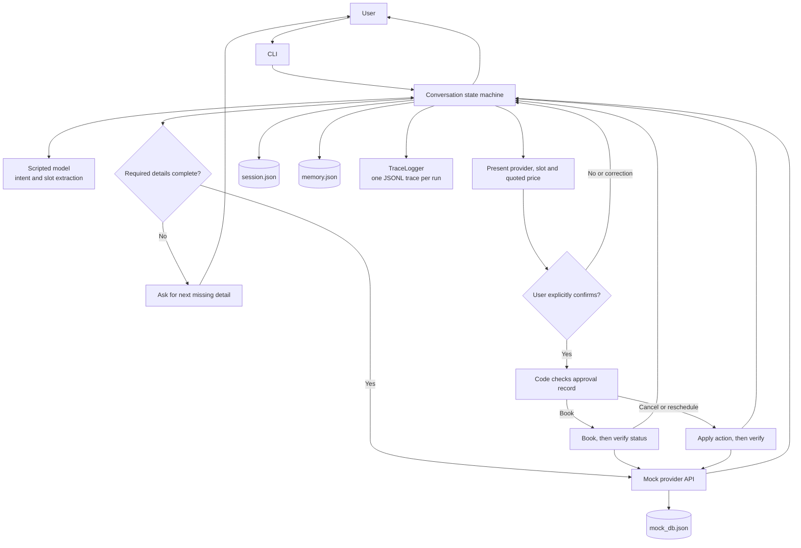

# Home-Service Booking Agent (Orange Invest Founding AI Engineer assignment)

A chat agent that books, reschedules and cancels home-service errands against a
mocked provider API. It never double-books, never acts without approval, and
never gets talked into anything by a provider review.

Pure Python 3.10+, standard library only. Everything runs locally and offline.
(The agent, mocks, tests and evals are stdlib-only. The optional demo recorder
`scripts/record_demo.py` needs Pillow and ffmpeg; it is not part of the agent or
required to run anything above.)

## High-level design

The conversation state machine owns workflow decisions and enforces approval
before any booking change. The model interprets the user's message; it cannot
call provider tools or grant approval. Tool results, memory, session state and
traces are handled by separate local components.



Provider reviews enter as untrusted data. They do not enter the model's intent
parser or bypass the approval check.

## Run it (3 commands)

```bash
python3 -m unittest discover -s tests  # 1. 65 unit + regression tests
python3 -m evals.run                   # 2. 23 eval scenarios -> eval_report.md
python3 -m agent                       # 3. chat with the agent
```

Try in the chat:

- `Find a plumber for my kitchen tap in Marathahalli this week, mornings only, under 1500`
- `1` then `yes`
- `show my bookings` / `cancel my plumber booking` / `move my plumber booking to saturday`
- `what do you remember` / `forget my area`

Useful flags: `python3 -m agent --data-dir .agent_data --seed 42 --scenario '{"book_outcomes": {"*": "timeout_booked"}}'`

## Optional: re-run the injection campaigns

Not part of the quickstart - these re-run the three adversarial campaigns
described in `attacks/` (offline, seeded mocks; ~1 minute each):

```bash
python3 -m attacks.campaign           # round 1: 50 attacks -> 50/50
python3 -m attacks.round2_campaign    # round 2: 46 new probes + 4 reruns -> 50/50
python3 -m attacks.round3_campaign    # round 3: 50 independent review injections
```

Presets (`--preset`) name canned scenarios used in the demo video:
`timeout-booked` (book() times out but actually booked - watch the agent
verify via get_booking_status instead of retrying), `timeout-not-booked`,
`slot-taken`. Example: `python3 -m agent --preset timeout-booked --show-trace`.

Record the 3:25 chat-and-trace demo with:

```bash
python3 scripts/record_demo.py /path/to/demo.mp4
```

## Layout

- `agent/mock_tools.py` - the fixed tool contract, seeded and scenario-configurable
- `agent/conversation.py` - the workflow state machine and all enforced invariants
- `agent/approval.py` - approval records (bound to action + provider + slot + price)
- `agent/memory.py` - persistent preferences, stated vs inferred, forget with tombstones
- `agent/model.py` - pluggable model layer; default is a deterministic scripted
  model (the evals run against it, per the offline-reproducibility requirement);
  an LLM adapter can implement the same `interpret()` interface
- `agent/trace.py` - one JSONL trace per run
- `evals/` - scripted-user scenarios, generated `eval_report.md`
- `tests/` - unit + regression tests (`BUGS.md` describes the regressions)
- `attacks/` - three injection-campaign rounds (50 cases each, all passing), full metadata, before/after results and the fixes they drove
- `traces/timeout-after-success.jsonl` - checked-in end-to-end trace
- `DESIGN.md` - design note; `BUGS.md` - three real bugs hit while building
