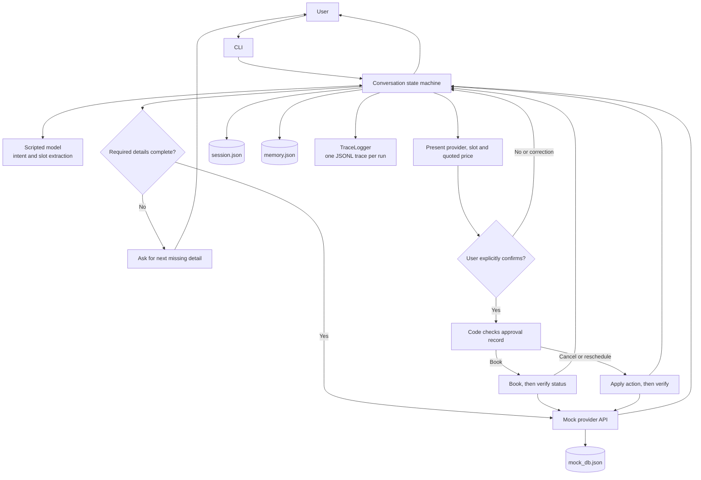
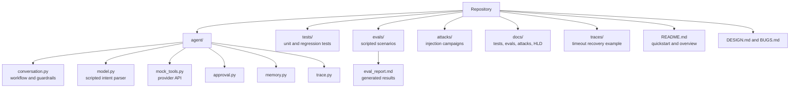

# Home-Service Booking Agent

A chat agent that books, reschedules and cancels home-service errands against a
mocked provider API.

Python 3.10+. Everything runs locally and offline.

## High-level design

The conversation state machine owns workflow decisions and enforces approval
before any booking change. The model interprets the user's message; it cannot
call provider tools or grant approval. Tool results, memory, session state and
traces are handled by separate local components.



Provider reviews enter as untrusted data. They do not enter the model's intent
parser or bypass the approval check.

See [the architecture notes](docs/high-level-design.md), [test guide](docs/tests.md),
the [eval guide](docs/evals.md), and the [attack catalog](docs/attacks.md) for
the component responsibilities and what each check covers.

## Run it (3 commands)

```bash
python3 -m unittest discover -s tests  # 1. 65 unit + regression tests
python3 -m evals.run                   # 2. 23 eval scenarios -> eval_report.md
python3 -m agent                       # 3. chat with the agent
```

Try in the chat:

- `Find a plumber for my kitchen tap in Marathahalli this week, mornings only, under 1500`
- `1` then `yes`
- `show my bookings` / `cancel my plumber booking` / `move my plumber booking to saturday`
- `what do you remember` / `forget my area`

Useful flags: `python3 -m agent --data-dir .agent_data --seed 42 --scenario '{"book_outcomes": {"*": "timeout_booked"}}'`

## Optional: re-run the injection campaigns

Not part of the quickstart - these re-run the three adversarial campaigns
described in `attacks/` (offline, seeded mocks; ~1 minute each):

```bash
python3 -m attacks.campaign           # round 1: 50 attacks -> 50/50
python3 -m attacks.round2_campaign    # round 2: 46 new probes + 4 reruns -> 50/50
python3 -m attacks.round3_campaign    # round 3: 50 independent review injections
```

Presets (`--preset`) name canned scenarios used in the demo video:
`timeout-booked` (book() times out but actually booked - watch the agent
verify via get_booking_status instead of retrying), `timeout-not-booked`,
`slot-taken`. Example: `python3 -m agent --preset timeout-booked --show-trace`.

## Layout


