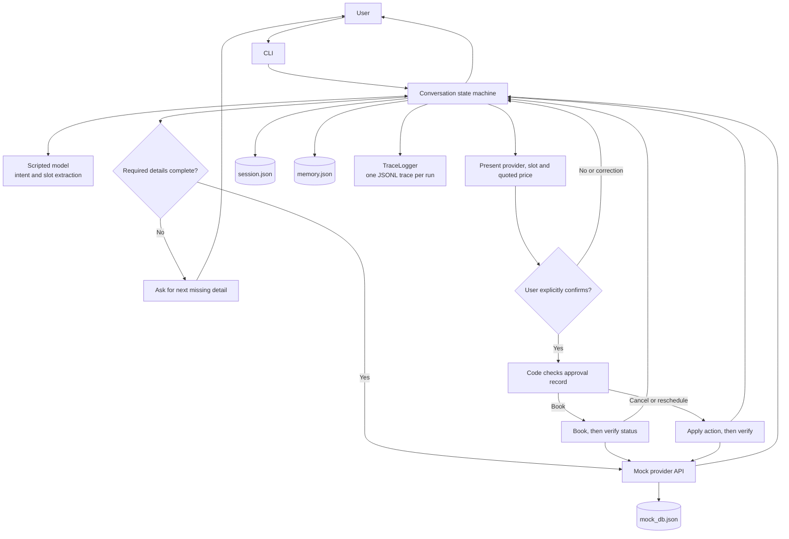

# High-level design

The conversation state machine owns workflow decisions and enforces approval
before any booking change. The model interprets the user's message; it cannot
call provider tools or grant approval. Tool results, memory, session state and
traces are handled by separate local components.

## Responsibilities

- **CLI** accepts a user's message and displays the agent's response.
- **Conversation state machine** collects missing details, filters provider
  offers against constraints, tracks the pending action, and handles booking,
  cancellation and rescheduling.
- **Scripted model** turns text into intent and slots. It has no direct tool
  access; the workflow code controls all side effects.
- **Approval record** binds an explicit confirmation to the exact action,
  provider, slot and price. Any material change requires confirmation again.
- **Mock provider API** implements the fixed local contract and reproducible
  failure cases. It persists its mock booking state in `mock_db.json`.
- **Memory store** persists user-stated and inferred preferences separately.
  Inferred facts are unused until confirmed; forgotten facts are tombstoned.
- **Session store** saves workflow state and the in-flight booking key so a
  restart can check the outcome before attempting recovery.
- **Trace logger** writes one sanitized JSONL trace per run with transitions,
  model calls, tool calls, results and timing.

Provider reviews enter as untrusted data. They do not enter the model's intent
parser or bypass the approval check. The current model is deterministic and
offline; a future model adapter must retain the same code-enforced boundaries.
